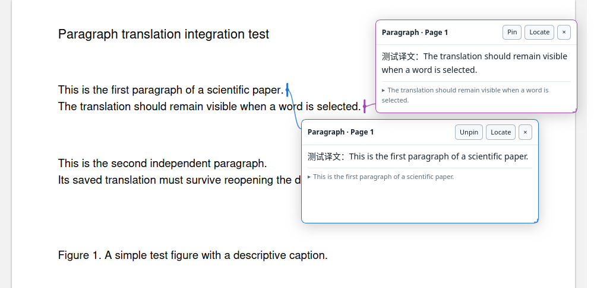
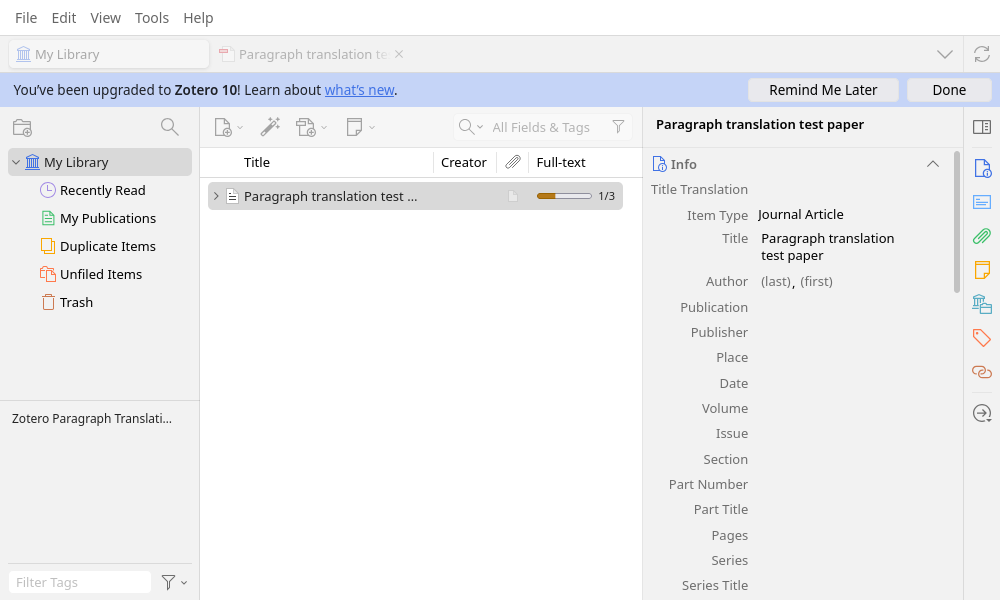

# Zotero Full-Text Translate

**Zotero 论文全文翻译：按段保存、与论文同步，在原 PDF 上展开可拖动和缩放的译文卡片。**

A fork of [Translate for Zotero](https://github.com/windingwind/zotero-pdf-translate) by windingwind,
focused on persistent full-paper translation and source-linked paragraph reading.



_使用仓库内原创测试 PDF 与模拟译文展示卡片及原文定位，不代表翻译服务的输出质量。_

## 功能

- 在文献列表右键选择「全文段落翻译／继续」，逐段翻译、保存并支持暂停和续翻。
- 每次启动先检查已有译文：完整则直接显示，部分则续翻，没有匹配译文才从零开始。
- 文献列表「全文翻译」列显示进度条和已保存／总段数，暂停、失败和完成可查看状态提示。
- 阅读器只增加一个三态小图标：未翻译、已有译文但未启用、已启用。
- 鼠标指向段落或题注，按 **Alt+T** 展开／收起译文，快捷键可配置。
- 标题栏拖动卡片，边框与四角调整宽高；支持同时固定多个卡片。
- 同色连线与段侧竖线指明原文范围，随 PDF 滚动和缩放更新。
- 译文存为论文关联的 Zotero 笔记，可通过 Zotero 数据同步恢复到另一台电脑。
- 译文笔记名称使用英文前缀 `Full-Text Translation`，兼容旧标题及跨设备中文语言编码。
- 沿用上游翻译服务、密钥设置、划词、词典和批注翻译；划词与全文任务各自保留结果。



## 安装

支持 **Zotero 10.0.6–10.x 桌面版**。Linux Zotero 10.0.6 已验证；Windows 尚未实机验证。

1. 从 [Releases](https://github.com/KiiiLin/zotero-fulltext-translate/releases) 下载 `zotero-fulltext-translate.xpi`。
2. 在 Zotero「工具 → 插件 → 齿轮 → 从文件安装插件」选择 XPI。
3. 沿用原翻译设置，配置正文服务和目标语言，然后在文献列表右键论文或 PDF 开始全文翻译。

此 fork 使用上游插件 ID，以接续已有设置和服务配置。安装时会替换原 Translate for Zotero，
不能与原版同时启用。插件更新地址指向本 fork 的 Release。

全文翻译会把论文文本发送至所配置的服务，实际用量取决于该服务。

## 保存与同步

译文绑定 PDF 附件 key、内容指纹和目标语言，保存为论文下的子笔记，长文自动分卷。
另一台电脑需同步相同论文和笔记、下载 PDF 并安装本插件。读取已有译文无需原服务密钥。
PDF 文件同步与笔记的数据同步分别遵循 [Zotero 同步设置](https://www.zotero.org/support/sync)。

旧版本地 JSON 缓存在打开译文或继续任务时迁入关联笔记。卡片布局属于当前显示会话，
全文译文则持久保存。识别质量依赖 Zotero SDT，未增加独立 OCR 或 PDF 重排。

详见 [中文使用说明与限制](PARAGRAPH_TRANSLATION.md) 和 [验证记录](PARAGRAPH_TRANSLATION_QA.md)。

## 构建与测试

```sh
npm ci
npm run test:fulltext
npm run build
# 可选：使用已安装的 Zotero，创建两个隔离配置，不使用个人文献库
npm run test:fulltext:zotero -- /path/to/zotero
```

构建产物：`build/zotero-fulltext-translate.xpi`。
`npm run release:prepare` 生成安装包、带 SHA-256 的更新清单和校验文件，供 Release 工作流上传。

当前验证覆盖 16 项核心测试与 45 项真实 Zotero 阅读器／安装／双配置恢复检查。
集成测试使用原创 PDF 和模拟服务，不消耗翻译额度；未执行真实账户云端往返同步。

## 上游与许可证

基于 windingwind/zotero-pdf-translate **v2.4.8**（`2e3d77ddbf3157d8813c61c828957386ab802bdb`）。
感谢 windingwind 和上游贡献者提供的翻译服务及阅读器集成。

保留 **AGPL-3.0-or-later** 许可证，见 [LICENSE](LICENSE)。
上游的完整服务说明见 [UPSTREAM_README.md](UPSTREAM_README.md)。
